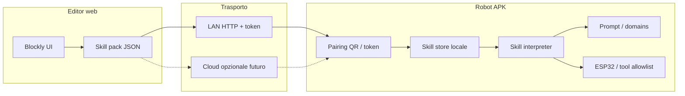

# Skill Editor (Blockly) + Pairing — Spec di design

> **Stato:** Draft — non implementato; idea di prodotto  
> **Data:** Agosto 2026  
> Editor web (PC / Netlify) basato su **Blockly** per definire funzionalità
> (prompt, policy, sequenze hardware) e pubblicarle sul robot via **pairing**,
> nello stesso spirito di [`NOTIFICATION_PROXY.md`](../NOTIFICATION_PROXY.md).

---

## 1. Scopo (e cosa NON è)

**Scopo:** permettere a un umano (anche non sviluppatore) di **comporre skill**
visualmente e spingerle sul desk robot senza rebuild APK.

**Esplicitamente NON in scope (v1):**
- Esecuzione di JavaScript / codice arbitrario sul telefono.
- Marketplace pubblico di skill di terzi senza review.
- Sostituzione completa di `llm_system_prompt.txt` / tool chain Kotlin.
- Cloud obbligatorio: sync remoto solo come fase successiva.

---

## 2. Idea in una frase

```
Blockly (Netlify/PC) → skill pack JSON versionato → pairing → robot interpreta
```

Blockly **non** gira sul robot. Compila un **modello dichiarativo** che l’app
valida e applica (prompt snippet, gate, sequenze corpo, toggle).

---

## 3. Architettura target



### 3.1 Sync — LAN-first (consigliato v1)

Allineato al proxy notifiche:

| Pezzo | Ruolo |
|-------|--------|
| Robot | HTTP server locale (es. porta dedicata o riuso pattern NanoHTTPD) |
| PC / telefono editor | stessa Wi‑Fi; QR con IP + porta + token |
| Payload | `POST /v1/skill` (o equivalente) con skill pack firmato/versionato |

### 3.2 Sync — Cloud (fase 2)

Netlify Functions + storage + account. Pairing da remoto. Trade-off: comodità vs
privacy / costo / auth. **Non** requisito MVP.

---

## 4. Modello skill (bozza)

Pacchetto versionato, **allowlist** di azioni — niente eval.

```json
{
  "schemaVersion": 1,
  "id": "morning_check",
  "name": "Controllo mattutino",
  "version": "1.0.0",
  "enabled": true,
  "triggers": {
    "type": "schedule",
    "windowLocal": { "startHour": 8, "endHour": 10 }
  },
  "gates": {
    "requireMicOn": true,
    "respectNightMode": true,
    "respectRobotSilentContext": true
  },
  "prompt": {
    "domainId": "custom_morning",
    "appendText": "Se l'utente è presente, saluta in modo breve…"
  },
  "actions": [
    { "type": "body_look_around", "params": { "moodHint": "neutral" } },
    { "type": "speak_if_allowed", "params": { "maxLines": 1 } }
  ]
}
```

### 4.1 Tipi azione candidati (allowlist)

| Tipo | Note |
|------|------|
| `prompt.append` / domain text | Solo sezioni note; no override system prompt intero in v1 |
| `body_*` (home, pan, look_around) | Solo joint/sequenze già supportate dal runtime |
| `speak_if_allowed` | Passa da `ProactiveSpeakGate` / policy esistenti |
| `enable_domain` / `disable_domain` | Wellness / attention toggles |
| `noop` | Skill solo documentale |

**Vietato in v1:** tool che modificano memoria senza conferma, dial/WhatsApp
automatici, fetch URL arbitrarie, shell.

---

## 5. Blockly — catalogo blocchi (MVP)

| Blocco UI | Compila in |
|-----------|------------|
| “Quando (orario / idle / manuale)” | `triggers` |
| “Se microfono acceso / non notte / non SILENT” | `gates` |
| “Aggiungi istruzione dominio …” | `prompt.appendText` |
| “Guarda intorno (corpo)” | `actions: body_look_around` |
| “Parla al massimo N righe se permesso” | `actions: speak_if_allowed` |

Esportazione: JSON (+ opzionale QR che punta a URL LAN di install).

---

## 6. Pairing e sicurezza

Riusare principi di [`NOTIFICATION_PROXY.md`](../NOTIFICATION_PROXY.md):

- Token monouso / revocabile; Wi‑Fi only in v1.
- Skill pack: `schemaVersion` obbligatorio; reject se sconosciuto.
- Firma opzionale (HMAC con secret di pairing) per anti-tamper su LAN.
- UI robot: elenco skill installate + revoke / disable.
- Nessuna esecuzione di codice Blockly sul device.

---

## 7. Mapping sul runtime esistente

| Skill field | Dove atterra (ipotesi) |
|-------------|-------------------------|
| `prompt.domainId` + text | Attention domains / asset override in DataStore (non solo `assets/`) |
| `gates` | Allinea a `UserPresencePolicy`, night mode, robot context |
| `body_*` | `BodyExpressionController` / tool HARDWARE già noti |
| `speak_if_allowed` | Stesso path proactive (cap / cooldown) |

**Principio:** skill = configurazione + coreografie; il LLM e i gate Kotlin
restano SSOT per “posso parlare?” e tool pericolosi.

Riferimenti: [`PROMPT_PHILOSOPHY.md`](../PROMPT_PHILOSOPHY.md),
[`PROACTIVE_ARCHITECTURE.md`](../PROACTIVE_ARCHITECTURE.md),
[`BODY_INTEGRATION.md`](../BODY_INTEGRATION.md).

---

## 8. MVP proposto

1. Schema skill v1 (JSON) + validatore Kotlin.
2. Editor minimale (Blockly o form) → export file JSON.
3. Robot: import via QR/LAN `POST /v1/skill` + lista in Impostazioni.
4. Solo 3 blocchi azione: append prompt dominio, look-around, speak_if_allowed.
5. Docs guide umana IT quando esce dallo stato Draft.

**Fuori MVP:** cloud Netlify Functions, marketplace, Blockly su mobile, override
system prompt completo.

---

## 9. Dubbi aperti

1. Skill pack in DataStore vs file in app storage? Quota / backup?
2. Chi vince se skill e domain built-in confliggono?
3. Serve “dry-run” (simula senza parlare/muovere)?
4. Multi-device: stesso account editor → più robot?
5. Internazionalizzazione blocchi Blockly (IT only v1?).
6. Versioning: migrazione `schemaVersion` 1 → 2 senza brickare il robot.

---

## 10. Relazione con roadmap

- **Non** sostituisce H3–H6 / proattività SSOT.
- È un **canale di estensibilità** UX, dopo stabilità core (presenza on-demand,
  smoke umore, ecc.).
- SSOT roadmap aperta resta [`TODO.md`](../TODO.md); questo file è solo draft.

---

## 11. Decisione (bozza)

| Domanda | Risposta draft |
|---------|----------------|
| Fattibile? | Sì |
| Stack editor | Blockly + static host (Netlify) ok |
| Trasporto v1 | LAN + token (pattern proxy) |
| Valore | Alto se si vuole estendere senza store update; basso se solo edit manuale assets |
| Prossimo passo implementativo | Congelare schema JSON v1 + validatore; editor può arrivare dopo |
