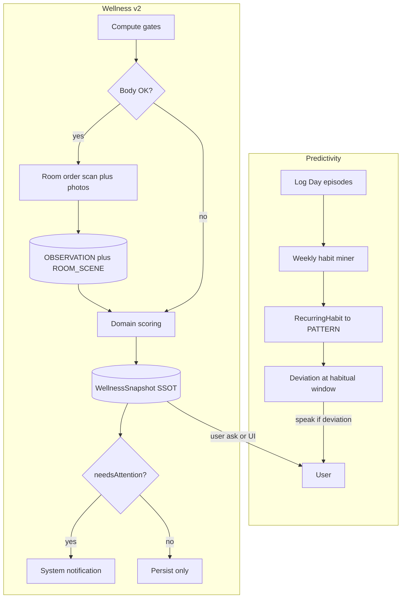
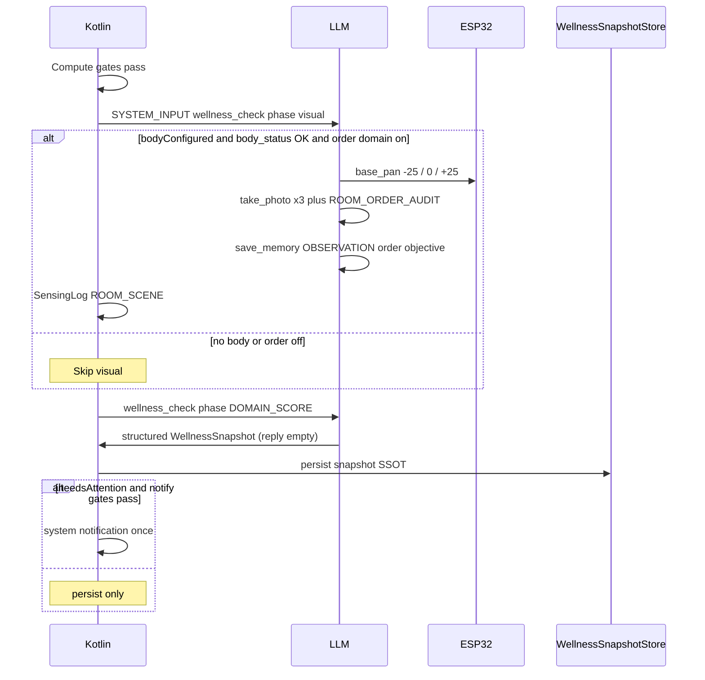

# Proactive Architecture — SSOT

**Target architecture** for user-facing proactivity: **Predictivity** + **Wellness**.  
Replaces the fragmented model of per-domain heartbeat triggers (`TimeDaily`, `EVENT nuova_foto`, round-robin in `AttentionDomainRepository`).

> **Runtime status:** Care domains run as Wellness toggles (not per-domain heartbeat schedules). See [HEARTBEAT_ARCHITECTURE.md](HEARTBEAT_ARCHITECTURE.md) for micro-tick / custom heartbeat shell.

---

## Overview

| Component | Talks to user? | Role |
|-----------|----------------|------|
| **Predictivity** | Yes (deviation prompts) | Learn recurring activities from Log Day; ask when habits break |
| **Wellness** | **No TTS by default** — notify if attention needed; voice only on user ask | Daily **compute** of care domains → persist snapshot (SSOT); optional system notification |
| **Room order (visual)** | **No** | Input **for** Wellness only: body scan + photos + order assessment → stored |

**Not three channels.** Room order is **not** a separate proactive speak path — it is silent data collection inside the Wellness tick (when ESP32 body is available).

> **Wellness v2 (ott 2026):** **compute ≠ communicate**. Scoring runs with light gates; results are **persisted** (`WellnessSnapshot`). Engagement is a **notification** (if a domain needs attention), not proactive TTS. The user may ask the robot about wellness anytime (`STATO WELLNESS` inject); settings → Proattività → Riepilogo wellness reads the same snapshot.



---

## Default constants

| Constant | Default | Meaning |
|----------|---------|---------|
| `N` (`wellnessAnchorMinutes`) | **15** (was 60 in v1) | Minutes after **first hotword-on of the day** before Wellness **compute** is eligible — only to avoid work at cold start |
| `R` (`wellnessRescoreIntervalMinutes`) | **180** (3 h) | Auto **DOMAIN_SCORE** again when today's snapshot is older than R; **VISUAL_ORDER** stays 1×/day; notify still 1×/day. On-demand («come sto?») forces DOMAIN_SCORE then answers |
| `idleMinutes` | — (v2) | **Removed from compute gates.** Was 5 min post-dialog buffer for v1 speak-coupled tick |
| `W` (`wellnessPresenceMinutes`) | — (v2 compute) | **Not required for compute.** Kept only if a future optional voice path is re-enabled |
| `wellnessNotifyCapPerDay` | 1 | Max Wellness **notifications** per day (replaces v1 `wellnessSpeakCapPerDay` TTS cap) |
| `wellnessSpeakCapPerDay` | 1 | **v1 only** — max spoken lines; retired when v2 notify ships |
| `predictivityPresenceMinutes` | 10 | Max minutes since last user turn for predictivity speak (without body locate) |
| `predictivityPromoteHitCount` | 7 | Distinct calendar days on same slot → confidence cap (~90%) |
| `predictivityMinHitCount` | 3 | Minimum slot hits before deviation speak is eligible |
| `predictivityMinConfidence` | 0.70 | Minimum slot confidence before deviation speak |
| `predictivityTimeToleranceMinutes` | 45 | ± window around `typicalTimeMinutes` for match and deviation |
| `predictivityMergeWindowMinutes` | 90 | Same-canonical slots/episodes within this circular distance are merged (hybrid miner) |
| `predictivityPatternTtlDays` | 30 | TTL for `PATTERN` habit slots in unified memory |

Configurable in **Impostazioni → Proattività** (toggles, wellness timing, **Abitudini dedotte** list/delete).

---

## Channel 1 — Predictivity

### Purpose

Observe what the user **reports doing** (walk at 8:30 every day, treadmill at 19:00, lunch at parents on Saturdays, going out in the evening) and, over time:

1. Detect **repeating slots** (same normalized activity + same time band on different **calendar days**).
2. **Predict** expected behaviour via rising slot confidence.
3. **Interact** when behaviour deviates: e.g. "You usually walk the dog around 8:30 — not today?"

Does **not** use user-initiated photos or the Wellness tick.

### Input

- [`activity_log.db`](ACTIVITY_LOG.md) episodes: `label`, `dayKey`, `timestampMs`, `eventKind`, optional `scheduledAtMs`
- Capture: `log_daily_activity` tool + background `ActivityExtractionService` from `conversationLog` + optional **Health Connect** exercise sync (`ActivitySource.HEALTH_CONNECT`, `sourceChannel=health_connect:<id>`)
- Miner reads only `PHYSICAL_NOW` + `CONFIRMED` for habit hits ( `PLAN` optional later for forward-looking patterns)

Log Day retention is **7 days**. Habit knowledge must live in **PATTERN** (30-day TTL), not in the log.

**Robot self-activity exclusion:** robot pastimes are written with prefix `[robot]` (channel `svago` for idle overlays). They must **never** enter user Log Day mining, habit slots, habit summary, or episodic recall (“cosa ho fatto oggi”). Filtered at parse, write, activity-log reads, unified episode lists, miner, and purged from habit slots on mine / Abitudini dedotte open.

---

### Incremental miner (silent, catch-up)

**No fixed weekly schedule** — the app cannot rely on the user opening it at a specific time.

#### When to run

| Trigger | Required |
|---------|----------|
| App / voice session start | Process all pending days |
| **Before** `ActivityLogRepository.pruneExpired()` | **Mandatory** — never delete episodes that were not mined |
| After new episodic extraction (optional) | Same day only if new events on an already-mined day are impossible (see idempotency) |

#### Watermark

Persist in DataStore (e.g. `predictivity_mining_v1`):

| Field | Meaning |
|-------|---------|
| `lastMinedDayKey` | Last `yyyy-MM-dd` fully processed by the miner |

**Catch-up:** on each run, process every `dayKey` such that `dayKey > lastMinedDayKey` and `dayKey < today` (yesterday and all missed days). Optionally include **today** only after local end-of-day or on next app open (implementation choice: default **mine through yesterday** on open; today mined next open).

**No re-mining the same calendar day:** once `lastMinedDayKey` advances past a day, that day is never processed again. New events appended the same day after mining must be rare; if needed, only allow same-day re-run before midnight via `minedDayKey` not yet equal to today.

#### Pre-prune sequence (mandatory)

```text
1. minePendingDays()     // catch-up + update PATTERN slots
2. pruneExpired()        // delete activity_log older than 7 days
```

Patterns already promoted survive in `memory_documents` / PATTERN.

#### Label normalization + Kotlin merge (hybrid)

Once per mining execution:

1. Collect distinct raw labels from pending days **and** existing habit slots.
2. **One** lightweight LLM call (`habit_label_normalize_prompt.txt`) with optional `existing_habits` context → `rawLabel → canonicalLabel`.
3. Kotlin applies local aliases + **meal-by-clock** refine (e.g. “pranzo” at 21:50 → `cena`).
4. Kotlin **merges** slots that share the same canonical and fall within `predictivityMergeWindowMinutes` (default **90**) — hit counts sum, typical time is weighted, slot key rewritten.
5. New episode hits attach to a compatible existing slot when possible (same canonical + time window) instead of always opening a new 30-minute bucket.

Cost remains one LLM call per mining run (app open / pre-prune). Hit counts and watermark stay Kotlin SSOT.

---

### Habit slot model

A **slot** is one recurring schematic pattern:

```text
slotKey = canonicalLabel + "|" + timeBucketMinutes
```

| Part | Rule |
|------|------|
| `canonicalLabel` | From normalization pass |
| `timeBucketMinutes` | `timestampMs` rounded to bucket (default **30 min**, e.g. 08:32 → 510) |

**Same activity, same time, different calendar days** → **one slot**, `hitCount` increments (e.g. walk dog 08:30 Mon, Tue, Wed …).

**Do not** split by day-of-week in the slot key. Daily habits and weekly habits share the same model: a Tuesday-only treadmill accumulates one hit per Tuesday; confidence grows slower (~1 hit/week) until `predictivityMinHitCount` / `predictivityMinConfidence` are met.

Optional metadata on the slot (derived, not part of key): histogram of `dayOfWeek` for deviation tuning (future).

#### Per-day mining algorithm

For each pending `dayKey` D:

```text
for each episode E on D where kind = PHYSICAL_NOW and confidence = CONFIRMED:
  canonical = labelMap[E.label]
  slotKey = canonical + "|" + timeBucket(E.timestampMs)
  if slot already received a hit on dayKey D: skip   // max 1 hit per slot per calendar day
  load or create HabitSlot(slotKey)
  slot.hitCount += 1
  slot.lastHitDayKey = D
  slot.typicalTimeMinutes = rolling average of hit times
  slot.confidence = min(0.90, slot.hitCount * (0.90 / predictivityPromoteHitCount))
  slot.displayLabel = human label from canonical
  persist as save_memory PATTERN (structured value + TTL predictivityPatternTtlDays)
advance lastMinedDayKey to D
```

**Confidence examples** (`predictivityPromoteHitCount = 7`):

| Distinct days same slot | confidence |
|-------------------------|------------|
| 1 | ~13% |
| 3 | ~39% |
| 5 | ~64% |
| 7 | **90%** (cap) |

**Deviation speak eligibility:** `hitCount >= predictivityMinHitCount` **and** `confidence >= predictivityMinConfidence`.

#### Stored PATTERN shape (example)

```json
{
  "slotKey": "passeggiata_cane|510",
  "canonicalLabel": "passeggiata_cane",
  "displayLabel": "Passeggiata con il cane",
  "typicalTimeMinutes": 510,
  "timeToleranceMinutes": 45,
  "hitCount": 7,
  "lastHitDayKey": "2026-06-11",
  "confidence": 0.90,
  "source": "activity_log_miner"
}
```

`ActivityHabitSummarizer` prose remains for human recall — **not** SSOT for the deviation watcher. In dialogue MEMORIA, habit slots and habit summary are **expected patterns** (`ABITUDINI ATTESE` / `PROFILO ABITUDINI`), never under `FATTI` and never treated as done episodes.

---

### User feedback and habit removal

| User signal | Action |
|-------------|--------|
| Confirms skip ("sì oggi salto") | OBSERVATION; optional temporary suppress for today |
| Denies deviation ("l'ho già fatto") | Improve logging / extraction; no penalty |
| **"Non lo faccio più" / "non è più un'abitudine"** | **`delete_memory`** on matching PATTERN slot (or all slots for topic) |
| **Impostazioni → Proattività → Abitudini dedotte** | List mined slots (label, typical time, window, hits/confidence, eligible); delete removes the PATTERN slot so deviation stops |
| Pattern absent for long period | Future: decay (out of scope v1) |

Voice, settings delete, or explicit forget flows must remove the slot so deviation stops.

---

### Deviation watcher (runtime)

**When:** current time in `[typicalTimeMinutes ± predictivityTimeToleranceMinutes]` for an eligible slot **and**:

- Mic / hotword session active
- Robot context not SILENT (WORK / CALL / MEETING / FOCUS)
- Proactive cap / cooldown respected
- `predictivityUserPresentEnough` (see below)
- No matching episode **today** (`dayKey` = today, same `canonicalLabel`, time within tolerance)

**If** deviation candidate → short question, low–medium `speak_confidence`, curious tone.

#### Predictivity presence (baseline)

Evaluated **at deviation window**, not at weekly schedule:

```text
predictivityUserPresentEnough =
  lastUserTurnWithin(predictivityPresenceMinutes)   // default 10 min
  OR (bodyOk && locateUserNow())                    // silent pan + face / detect_presence
```

- **Body connected alone** ≠ presence.
- Without body and no user turn in 10 min → **silence** (no deviation speak).

---

### Kotlin vs LLM

| Kotlin | LLM |
|--------|-----|
| Watermark, catch-up days, pre-prune order, slot keys, hitCount, confidence, gates, deviation window, meal-by-clock refine, same-canonical time-window merge | One batch label normalize per mining run (with existing habit context); deviation phrasing |

### Source files (target)

| File | Role |
|------|------|
| `ActivityLogRepository` | Episodes; **mine before** `pruneExpired()` |
| `ActivityHabitSummarizer` | Legacy narrative summary (recall only) |
| *Future:* `RecurringHabitSlotMiner`, `HabitSlotRepository`, `DeviationWatcher` | Incremental mining + runtime |

---

## Channel 2 — Wellness

### Purpose (v2 target)

Once per day (when **compute** gates pass), run a **unified check**:

1. Optionally capture **room order** (body only) — always silent.
2. Score care domains: meals, workload, movement, social contacts, **order** (if data available).
3. **Persist** a structured **WellnessSnapshot** (single SSOT for UI, notify, and on-demand dialogue).
4. **Communicate** only if needed: system **notification** when ≥1 domain needs attention — **not** proactive TTS.

**Voice:** the user asks (“come sto?”, “wellness”, “come vanno i pasti?”) → robot answers from the **latest snapshot** (no mandatory recompute).  
**UI:** a summary page lists per-domain status from the same snapshot.

**Silence / non-interrupt is the default.** Compute may run in the background; talking is never the delivery path for the daily check.

### Design principle — compute ≠ communicate

| Concern | Responsibility |
|---------|----------------|
| **Compute** | Kotlin schedules tick; LLM scores + emits structured snapshot; store persists |
| **Communicate** | Kotlin: optional notification from snapshot; TTS only on user ask (normal dialogue) |
| **SSOT** | Last successful `WellnessSnapshot` written by the DOMAIN_SCORE turn — **not** a parallel Kotlin scorecard |

Do **not** keep a second Kotlin-computed score for UI while the LLM writes another judgment. Inject habit/log context freely; the **persisted snapshot is authoritative**.

### Health Connect (exercise → Log Day)

When `ProactivitySettings.healthConnectEnabled` is on and the user granted Health Connect **exercise read** permission, `HealthConnectExerciseSync` runs **before** Wellness `DOMAIN_SCORE` (and on voice session / app catch-up). Sessions become confirmed `PHYSICAL_NOW` episodes so **Today activities** and dialogue EPISODI see real workouts (e.g. bike from Google Fit via Health Connect). Expected habits remain comparison-only. Sync is best-effort no-op if HC is missing or permission denied.

### Compute gates (Kotlin) — v2

All must pass before `SYSTEM_INPUT: wellness_check` **compute** phases:

| Gate | Rule |
|------|------|
| Wellness enabled | `ProactivitySettings.wellnessEnabled` (**not** micro-tick / `HeartbeatSettings.enabled`) |
| Not busy | LLM idle (no Thinking/Speaking/ActiveListening/CapturingImage / open tool chain) |
| Night | Suppress whole tick at night |
| Translation mode | Off |
| Daily anchor | `now - firstHotwordOnToday >= N` minutes (`N` default **15**) — timestamp set on first app session / hotword of the day |
| Rescore | DOMAIN_SCORE when no today's snapshot **or** age ≥ `wellnessRescoreIntervalMinutes` (default 3 h), or **force** on wellness ask; `wellnessCheckDoneToday` is bookkeeping only. Visual done once/day after VISUAL_ORDER |
| Body for visual | `ordine_ambiente` on **and** body configured+reachable → may run `VISUAL_ORDER`; else skip visual |

**Removed from compute (were v1 speak-coupled):**

| Gate (v1) | v2 |
|-----------|-----|
| Mic / hotword session | **Dropped** — dedicated ViewModel scheduler; compute runs with mic off |
| Idle buffer ≥ 5 min after last user turn | **Dropped** — dialog overlap handled by **LLM idle** only |
| User presence / body `locateUser` | **Dropped** for compute — presence is irrelevant to saving a snapshot |
| Robot context SILENT | Does **not** block compute; **does** block **notification** (see below) |

**Persist:** DOMAIN_SCORE marks the day done **only** if `WellnessSnapshot` was saved. Missing `wellness` JSON → retry later (and recover if a prior bug set done without snapshot).

**Independent from predictivity** speak gates.  
**Not** gated on ML Kit `DeskPresenceGate`.

### Notify gates (Kotlin) — after snapshot saved

| Gate | Rule |
|------|------|
| Snapshot has ≥1 domain in `attention` or `critical` | Else no notification |
| `wellnessNotifyCapPerDay` not exceeded | Default 1 |
| Robot context not SILENT | Same policy family as notification TTS suppress |
| Notification permission / channel available | Else persist only |

Notification copy: soft, non-imperative, non-shaming (same tone as former speak). Deep link / tap → optional Wellness summary UI.

### WellnessSnapshot (SSOT schema)

Emitted by the DOMAIN_SCORE LLM turn (structured tool result or JSON side-channel — implementation choice); validated and stored by Kotlin.

```text
WellnessSnapshot {
  computedAtMs: Long
  dayKey: yyyy-MM-dd
  domains: [
    {
      id: pasti | carico_lavoro | attivita_fisica | contatti_sociali | ordine_ambiente | custom_*
      status: ok | attention | critical
      summaryIt: short Italian rationale (1 sentence, for UI + ask)
    }
  ]
  needsAttention: Boolean   // any attention|critical
  notifySuggested: Boolean  // LLM or Kotlin: true if user should get a cue today
  visualOrderDone: Boolean
}
```

| Consumer | Reads |
|----------|--------|
| Summary UI | Full `domains[]` |
| Notification | `needsAttention` + top domain `summaryIt` |
| Dialogue ask | Inject latest snapshot (or tool `get_wellness_status`) into MEMORIA / context |

Replacing the snapshot on the next successful daily compute is expected — one current SSOT, not dual histories (optional: keep last N days later).

### Wellness pipeline (v2)



#### Phase 1 — Gate (Kotlin only)

Schedule: poll every ~5 min while process eligible (same loop as mood monitor), or dedicated scheduler. Does **not** wait for idle-after-dialog or presence.

#### Phase 2 — Visual order (conditional)

**Prerequisite:** [`BodySettings.isConfigured()`](../app/src/main/java/com/example/mydeskrobot/data/body/BodySettingsRepository.kt) **and** body reachable; domain `ordine_ambiente` enabled.

**Not** required: ML Kit presence, user at desk, user dialog photos.

**Actions (mandatory 3-angle scan — once/day cost accepted):**

- `base_pan` ≈ **−25 / 0 / +25**, each followed by `take_photo`.
- Playbook [`room_order_audit_prompt.txt`](../app/src/main/assets/prompts/room_order_audit_prompt.txt) (`ROOM_ORDER_AUDIT`).
- Evaluate clutter/order only — **no** object inventory / landmark identity.
- **Judgment in OBSERVATION is objective** (`ordinato` | `disordinato` | `molto_disordinato`). Soft wording is for **notification / ask**, not for stored OBS.
- `save_memory` OBSERVATION + `SensingLogRepository.record(SensingKind.ROOM_SCENE)`.

**Without body:** skip phase 2; score text-only domains.

#### Phase 3 — Domain scoring → snapshot

Inputs (unchanged):

| Domain | Signals |
|--------|---------|
| Meals | Habit summary, today's PHYSICAL_NOW meals, PATTERN lunch times. **No meal logged after usual window → attention** (absence ≠ ok; do not invent eaten) |
| Workload | Late sessions, weekend work episodes, PATTERN, **`WORK_THREAD` (Teams/Slack)** |
| Movement | Missing walk/gym vs PATTERN, habit summary (+ HC exercises as done) |
| Social | Personal `SOCIAL_THREAD` only (WhatsApp/Telegram/SMS…). **Teams/Slack never count as vita sociale** |
| Order | Fresh OBSERVATION from phase 2 only |

LLM produces **WellnessSnapshot** (structured). Prefer `reply: ""` on this system turn (no TTS). Kotlin validates and persists.

#### Phase 4 — Notify (optional) + ask / UI

- **Notify:** if snapshot `needsAttention` and notify gates pass → one notification / day.
- **Ask:** user utterance → dialogue uses stored snapshot (inject or tool).
- **UI:** Wellness summary page binds to store.

### Wellness domains vs attention domain toggles

Care domains in [`AttentionDomainRepository`](../app/src/main/java/com/example/mydeskrobot/data/heartbeat/AttentionDomainRepository.kt) (`pasti`, `carico_lavoro`, `attivita_fisica`, `contatti_sociali`, `ordine_ambiente`) and **user custom domains** (name + prompt) are **not** separate scheduled triggers. They are **toggleable scopes** for the unified Wellness compute:

| Domain id | Role in Wellness |
|-----------|------------------|
| `pasti` / `carico_lavoro` / `attivita_fisica` / `contatti_sociali` | Scored in `DOMAIN_SCORE` when enabled |
| `ordine_ambiente` | When enabled: silent `VISUAL_ORDER` **before** score (body required); then scored from fresh OBS |
| `custom_*` (user-authored) | Scored in `DOMAIN_SCORE` using the user prompt |

Room identity (`set_current_place` / spatial SSOT) is **not** an attention domain.

### v1 runtime (until code migration)

Code still couples tick to mic + idle + presence and may TTS one soft line (`wellnessSpeakCapPerDay`). Treat that as **legacy behaviour**; new work implements v2 gates + snapshot + notify. Do not extend v1 speak path.

---

## Room order — input for Wellness (not a channel)

| Rule | Detail |
|------|--------|
| User dialog photos | **Never** reused for order assessment |
| `EVENT nuova_foto` | **Deprecated** — remove fire from `ConversationViewModel` on user `take_photo` |
| `ordine_ambiente.txt` as standalone heartbeat domain | **Removed** — order is Wellness phase `VISUAL_ORDER` then score |
| Prompt | `ROOM_ORDER_AUDIT` — distinct from [`FreshVisionVerifyPrompt`](../app/src/main/java/com/example/mydeskrobot/reasoning/memory/FreshVisionVerifyPrompt.kt) (dialog "what do you see") |
| Body required | Phone-only fixed front camera cannot pan — order dimension skipped |
| User interaction | None required; no TTS from order phase alone |

### Stored shape (OBSERVATION example)

```
12 giugno 2026: scrivania disordinata — tazze e fogli sparsi; ordine: disordinato
```

Optional structured fields in future Kotlin DTO: `orderLevel` = `ordinato` | `disordinato` | `molto_disordinato`.

---

## UserPresencePolicy

Replaces ML Kit `DeskPresenceGate` for proactive **speak** paths that still need a human nearby (chiefly **Predictivity**).

### Wellness v2

**Compute and notify do not use UserPresencePolicy.** Visual order needs body **reachability** (HTTP), not `locateUser` / face presence.

### Predictivity (baseline — unchanged)

```text
predictivityUserPresentEnough =
  lastUserTurnWithin(10 minutes)
  OR (bodyOk && locateUserNow())
```

Evaluated at **deviation window** time. Body locate = on-demand scan (pan + face), not "ESP32 online".

| Action | Presence required? | Notes |
|--------|-------------------|--------|
| Wellness compute (visual + score) | **No** | Anchor + LLM idle + once/day |
| Wellness notification | **No** (SILENT context may suppress) | From snapshot |
| Predictivity deviation TTS | Yes (10 min OR locate) | Unchanged |

### Scenario table (v2)

| Scenario | Wellness compute | Predictivity speak |
|----------|------------------|-------------------|
| Spoke 8 min ago, no body | Yes (if anchor+idle LLM) | Yes |
| Spoke 30 min ago, no body | Yes | No |
| Never spoke today, after anchor N | Yes | No |
| LLM busy mid-chain | No | No |

ML Kit [`DeskPresenceMonitor`](DESK_PRESENCE.md) remains on-demand for dialog centering / locate — not a Wellness compute gate.

### v1 note

Until migration, Wellness tick still used body-first presence + idle buffer; see git history / code `WellnessWatcher`.

---

## Predictivity vs Wellness

| | Predictivity | Wellness (v2) |
|--|--------------|----------|
| Trigger | Habitual time window | T+N after first hotword-on (light anchor); LLM idle |
| Enable switch | `predictivityEnabled` | `wellnessEnabled` |
| Data | Log Day episodes | Habit summary, log, PATTERN, order OBS → **snapshot** |
| Photos | Never | Only room order in Wellness tick (body) |
| User cue | Deviation **question** (TTS; cap/cooldown) | **Notification** if attention; TTS only on ask |
| Presence | 10 min turn OR body locate | Not for compute |
| Mining | Incremental catch-up + pre-prune | — |
| UI | Abitudini dedotte | Wellness domain summary (from snapshot) |

`HeartbeatSettings.enabled` = **micro-tick look-around only** (eyes/body in mood loop, no LLM, no AlarmManager).

---

## Migration from legacy heartbeat

| Legacy | Target |
|--------|--------|
| `DomainScheduler` round-robin + `TimeDaily` / `EVENT` triggers for care domains | Single Wellness scheduler; care domains = toggles only |
| `EVENT nuova_foto` → `ordine_ambiente` | Removed |
| `onDomainEvent("nuova_foto")` / `cambio_stanza` as attention domain | Removed from care path; room identity via spatial SSOT only |
| `ProactiveGatePolicy` + ML Kit for all proactive | ML Kit optional; `UserPresencePolicy` for Predictivity (not Wellness v2 compute) |
| Wellness proactive TTS | Replaced by snapshot + notification + on-demand ask |
| `assets/prompts/domains/*.txt` per tick | Care prompts optional reference; runtime uses `wellness_check_prompt.txt` + `room_order_audit_prompt.txt` |
| `HEARTBEAT_PLAYBOOK` on domain ticks | `WELLNESS_CHECK` / room-order prompts for Wellness; playbook only for remaining custom heartbeat ticks |
| Idle look-around (bored / mood loop) | **Keep** — zero LLM, in VM mood poll; see [HEARTBEAT_ARCHITECTURE.md](HEARTBEAT_ARCHITECTURE.md) |
| Critic pass (HIGH domains) | **Removed** — superseded by Wellness/Predictivity gates + `speak_confidence` |
| `weekly_reflection` | Keep; complement Predictivity miner (robot stats vs user habits) |

### Code references (migration complete for care domains)

- [`AttentionDomainRepository.kt`](../app/src/main/java/com/example/mydeskrobot/data/heartbeat/AttentionDomainRepository.kt) — care catalog + toggles; `enabledCareDomainIds()` / `enabledHeartbeatDomains()`
- [`WellnessWatcher.kt`](../app/src/main/java/com/example/mydeskrobot/integration/wellness/WellnessWatcher.kt) — today: v1 gates; **target:** compute gates only + phase order `VISUAL_ORDER` → `DOMAIN_SCORE`
- Spatial place change no longer emits attention-domain events
- **To add (v2):** `WellnessSnapshot` store/DTO, notify path, summary UI, dialogue inject/tool, drop idle/presence from watcher

---

## Prompt assets

| Label | Asset | Injected when |
|-------|-------|---------------|
| `WELLNESS_CHECK` | `wellness_check_prompt.txt` | `SYSTEM_INPUT: wellness_check` DOMAIN_SCORE — update for structured snapshot, `reply: ""` |
| `ROOM_ORDER_AUDIT` | `room_order_audit_prompt.txt` | Wellness tick phase 2 (vision turn) |
| `HABIT_LABEL_NORMALIZE` | `habit_label_normalize_prompt.txt` | One batch call per incremental mining run |

See [PROMPT_PHILOSOPHY.md](PROMPT_PHILOSOPHY.md).

---

## Implementation phases (roadmap)

See [TODO.md](TODO.md) — Wellness v2 + H7 follow-ups.

1. **Docs** — this file + guide (Wellness v2) — **done**
2. **Plan** — snapshot storage, gate matrix, notify vs ask vs UI — **done**
3. **Wellness v2 code:** watcher gates, snapshot persist, notify, retire proactive TTS, summary UI, ask path — **done** (smoke manuale aperto)
4. **Predictivity** — unchanged by this redesign (separate channel)

---

## Related docs

- [ACTIVITY_LOG.md](ACTIVITY_LOG.md) — Predictivity input
- [BODY_INTEGRATION.md](BODY_INTEGRATION.md) — Room order scan
- [DESK_PRESENCE.md](DESK_PRESENCE.md) — ML Kit vs `UserPresencePolicy` (Predictivity)
- [ROBOT_CONTEXT.md](ROBOT_CONTEXT.md) — WORK/CALL silence (blocks notify, not compute)
- [HEARTBEAT_ARCHITECTURE.md](HEARTBEAT_ARCHITECTURE.md) — Legacy runtime (superseded for domains)
- [PROMPT_PHILOSOPHY.md](PROMPT_PHILOSOPHY.md) — Prompt labels
- [guides/PROATTIVITA.md](guides/PROATTIVITA.md) — Human overview (IT)
